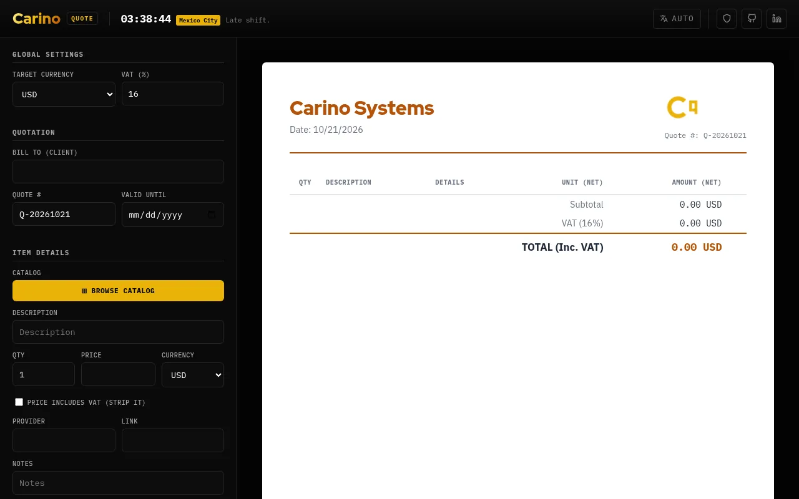

# Quote
A general quotation template to make simple quotes.
https://quote.carino.systems




## Catalogs

The catalog browser switches between the built-in catalogs (General, and Carino's Retina, PACS and
Infraestructura lines, also reachable as `?catalog=retina|pacs|infra`), **My catalog** and a
**published catalog**. Categories can be hidden from the browser; *DICOM & Medical Imaging* is hidden by
default.

**Edit your own:** Export › *Edit catalog* (or ✎ in the catalog browser). Edit the rows in place, or
import a `.json` or a spreadsheet saved as `.csv`, and *Save as my catalog*. It stays in this browser.
Export it as JSON or CSV at any time; the CSV round-trips through Excel or Google Sheets.

CSV columns: `category, description, provider, price, currency, vat_included, note, link`
(Spanish headers such as *categoría, descripción, precio, moneda, IVA incluido* work too; `,` `;` or tab).
An empty price means *quoted after a visit*.

**Publish one for a team** (the same model as [Desk](https://desk.carino.systems)): host the exported
JSON at an `https://` URL that sends `Access-Control-Allow-Origin` (GitHub Pages, S3, R2, any web
server), then connect it in the editor or hand people a link:

```
https://quote.carino.systems/?catalog=https://your-org.example.com/catalog.json
```

The link never applies silently: Quote names the host and asks once. It re-checks the file on every
load, when the tab regains focus and every 5 minutes (conditional requests when the host exposes
`ETag`/`Last-Modified`), keeps the last good copy if the host is down, and never changes items already
on a quote. Links in a catalog are kept only when they are `http(s)`.

A catalog can carry **defaults** for the quote (`"defaults": { "currency": "MXN", "vatRate": 16 }`, set
in the editor as *Quote defaults*). Picking the catalog applies them at once to an empty quote and asks
first when the quote already has items. Carino's three line catalogs default to MXN with 16 % IVA.

```jsonc
{ "appType": "carino_quote_catalog", "version": 1, "name": "Acme services", "revision": "4",
  "defaults": { "currency": "MXN", "vatRate": 16 },
  "hiddenCategories": ["Internal"], "disclaimer": "Prices before VAT.",
  "items": [ { "category": "Support", "description": "On-site visit", "price": 1500, "currency": "MXN",
               "vatIncluded": false, "note": "CDMX", "link": "https://example.com" } ] }
```

## Exchange rates and the disclaimer

Rates come from `carino-fx.js`, shared with [currency.carino.systems](https://currency.carino.systems):
the ECB reference rates through Frankfurter, with open.er-api.com for currencies the ECB does not publish
(COP, ARS, CLP, PEN…). On `*.carino.systems` the latest snapshot is shared between the sites through a
small cookie, so a rate fetched on one is reused by the other for six hours. In the rates box you can
type a rate by hand (for example the DOF *FIX* for USD in Mexico), and **lock** the rates on a quote so
it keeps the numbers it was priced with. When a quote mixes currencies, the rate used is printed under
the totals.

Every item added from a catalog remembers which catalog and revision it came from, and the quote prints
it under the totals (e.g. *Catálogo: Infraestructura · rev. 2026-10-28*), so a quote can always be traced
to the price list it was made from. Items typed by hand carry no stamp.

*Add a QR code* (off by default) prints a QR under the totals, in the PDF (clickable) and in the image
export: a link to the active catalog (a built-in one, or a published one; *My catalog* lives only in
the browser, so it has to be published first), to the organisation's website, or to any `https://` link,
with an optional caption.

*Add a disclaimer* (off by default) prints your own terms under the quote, in the PDF, the
spreadsheet and the e-mail, with one-click lines for validity, VAT, deposit and exchange rate.

## Licensing

**Mine — GNU Affero General Public License v3.0 or later.** Everything in this
repository *except* the paths listed below. Copyright © 2026 Miguel Carino.
Full terms in [LICENSE](LICENSE).

**Not mine.** The files below are third-party works redistributed here. This
project's licence does not cover them and could not: they are not mine to
relicense. Each keeps its own terms, and each carries its own notice.

| Path | What it is | Licence | Notice |
| --- | --- | --- | --- |
| [`fonts/`](fonts/) | IBM Plex Mono, IBM Plex Sans, Noto Sans JP, Red Hat Display | SIL OFL 1.1 | [`fonts/OFL.txt`](fonts/OFL.txt) |
| [`vendor/`](vendor/) | third-party JavaScript | per package — see the notice | [`vendor/README.md`](vendor/README.md) |

Those files travel with any fork, mirror or repackaging of this repository, and
their notices must travel with them.
